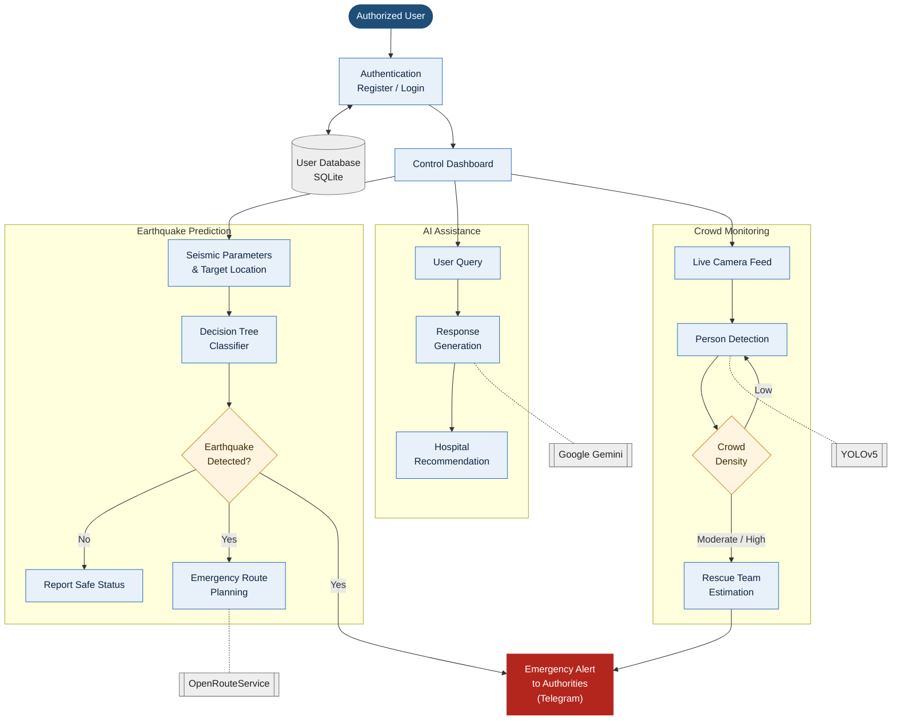

# 🌍 Disaster Response System

This project is designed to aid in quick decision-making during earthquake disasters by integrating machine learning, computer vision, real-time APIs, and Telegram-based communication. It predicts whether an earthquake has occurred from seismic parameters, alerts authorities over Telegram, draws a route map to the affected location, detects crowd density from a camera feed, and offers a Gemini-powered assistant chatbot.

---

### 🧰 Technologies Used

* **Backend**: Python 3.9, Flask
* **Frontend**: HTML, CSS, Bootstrap (Jinja templates)
* **Database**: SQLite (`user_data.db`)
* **Machine Learning**: scikit-learn (Decision Tree classifier, `model/dtt.pkl`)
* **Computer Vision**: YOLOv5 (PyTorch) for crowd/person detection (`best.pt`)
* **APIs**: Google Gemini AI, Telegram Bot API, OpenRouteService (routing)
* **Libraries**: Pandas, NumPy, telepot, google-generativeai, folium, OpenCV

---

### 📂 Project Structure

* `app.py` – Main Flask app; handles login/registration, earthquake prediction, chatbot and crowd routes
* `RouteMap.py` – Fetches a driving route from OpenRouteService and saves it as `static/route_map.html` (folium)
* `crowd.py` – Runs YOLOv5 person detection on the webcam using `best.pt`, classifies crowd level and sends Telegram alerts
* `best.pt` – Trained YOLOv5 weights used by `crowd.py`
* `model/dtt.pkl` – Trained Decision Tree model used for earthquake prediction (`model/dt.pkl` is an older copy)
* `NOTEBOOK_FILES/` – Jupyter notebook (`earth-2 (1).ipynb`) and dataset (`earth.csv`) used to train and compare the ML models
* `data.csv` – Hospital list (name, condition, Google Maps link) used by the chatbot
* `user_data.db` – SQLite DB storing registered users
* `templates/` – HTML frontend files
* `static/` – CSS, images and the generated route map
* `models/`, `utils/`, `data/` – YOLOv5 framework code and configs
* `detect.py`, `train.py`, `val.py`, `export.py`, `benchmarks.py`, `hubconf.py` – Standard YOLOv5 scripts (inference, training, validation, export, benchmarking)
* `.env.example` – Template for the `.env` file that holds the API keys
* `requirements.txt` – YOLOv5 dependencies (the web-app dependencies are installed separately, see below)
* `documents/` – Project report, paper, synopsis and presentation

---

### 🔄 Workflow



The system has three modules, all reached from one dashboard after login. **Earthquake Prediction** classifies seismic readings and, when an earthquake is detected, plans an emergency route to the location. **AI Assistance** answers queries and recommends hospitals. **Crowd Monitoring** watches a live camera feed and estimates how many rescue teams a crowd needs. Earthquake detections and moderate or high crowds both trigger a Telegram alert to authorities.

---

### ⚙️ Installation

**Prerequisites:**

* Python 3.9 (3.8–3.10 work; the saved model needs scikit-learn 1.0.2, which does not support Python 3.11+)
* Git
* A webcam (only for the crowd-detection feature)
* Telegram Bot Token and the chat ID that should receive alerts (create a bot with [@BotFather](https://t.me/BotFather))
* Google Gemini API Key ([Google AI Studio](https://aistudio.google.com/app/apikey))
* OpenRouteService API Key ([openrouteservice.org](https://openrouteservice.org/dev/#/signup))

**Steps:**

1. Clone the repository:

```
git clone https://github.com/hbhat-b/disaster-response-system.git
cd Disaster_Response_System
```

2. Create and activate a virtual environment:

```
python3.9 -m venv venv
source venv/bin/activate        # On Windows: venv\Scripts\activate
```

On Windows, if `python3.9` is not found, use `py -3.9 -m venv venv`.

3. Install dependencies.
   `requirements.txt` only covers the YOLOv5 part, so install the web-app packages as well:

```
pip install --upgrade pip
pip install -r requirements.txt
pip install flask python-dotenv telepot google-generativeai folium "scikit-learn==1.0.2" "numpy<2"
```

> `scikit-learn==1.0.2` is required because `model/dtt.pkl` was saved with that version; newer versions may fail to load it. For GPU support, install PyTorch first by following [pytorch.org/get-started](https://pytorch.org/get-started/locally/).

4. Configure API keys.
   Keys are read from a `.env` file in the project root (loaded with `python-dotenv`). Copy the example file and fill in your own values:

```
cp .env.example .env            # On Windows: copy .env.example .env
```

```
TELEGRAM_BOT_TOKEN=your-telegram-bot-token
TELEGRAM_CHAT_ID=your-telegram-chat-id
GEMINI_API_KEY=your-gemini-api-key
GEMINI_MODEL=gemini-pro
ORS_API_KEY=your-openrouteservice-api-key
```

   `.env` is listed in `.gitignore`, so never commit it. If Gemini returns a "model not found" error, set `GEMINI_MODEL` to a model that is currently available (for example `gemini-1.5-flash`).

   To get your chat ID, send any message to your bot and open `https://api.telegram.org/bot<YOUR_TOKEN>/getUpdates`; the ID is in `message.chat.id`.

5. Check the model files.
   Make sure `model/dtt.pkl` and `best.pt` are present. If `dtt.pkl` is missing, open `NOTEBOOK_FILES/earth-2 (1).ipynb` in Jupyter, run all cells (it trains on `earth.csv` and saves `dtt.pkl`), then move the file into `model/`.

6. Database.
   `user_data.db` is included. If you delete it, it is recreated automatically the first time a user registers.
   Passwords are stored as salted hashes (Werkzeug). Accounts created before hashing was added still have plaintext passwords; each one is converted to a hash automatically the next time that user logs in.

---

### ▶️ Running the Project

Run the commands from the project root folder (the app loads `model/`, `data.csv` and `user_data.db` using relative paths).

**Using Command Line**

```
source venv/bin/activate        # On Windows: venv\Scripts\activate
python app.py
```

**Using IDLE 3.9**
Open `app.py` in IDLE and press F5 or go to `Run > Run Module`.

Open your browser and visit:
[http://localhost:5000](http://localhost:5000)

**Using the app:**

1. Register and log in from the login page (`/index`).
2. **Prediction** – enter the destination coordinates as `latitude,longitude` and the seismic parameters. If an earthquake is predicted, a Telegram alert is sent and a route map is shown.
3. **Chatbot** (`/chatbot`) – ask questions; Gemini answers and a nearby hospital is suggested when the query mentions a condition from `data.csv`.
4. **Crowd detection** (`/crowd`) – starts `crowd.py`, which opens the webcam, counts people and sends Telegram alerts for moderate/high crowds. It keeps running until you press `Ctrl+C` in the terminal (this also stops the Flask server, so restart it with `python app.py`).

You can also run crowd detection on its own:

```
python crowd.py --weights best.pt --source 0      # 0 = webcam, or a path to a video/image
```

---

### 📱 Telegram Integration

* When an earthquake is predicted, the bot sends an alert with the latitude and longitude to the configured chat
* During crowd detection, the bot sends alerts with the crowd level and the number of rescue teams needed

---

### 📊 ML Model Info

* Dataset: Earthquake data (Kaggle), `NOTEBOOK_FILES/earth.csv`
* Models compared: Logistic Regression, KNN, SVM, Naive Bayes, Random Forest, Decision Tree
* Model used: Decision Tree Classifier (~94% test accuracy)
* Features used (11): Depth, Depth Error, Depth Seismic Stations, Magnitude, Magnitude Type, Magnitude Error, Magnitude Seismic Stations, Azimuthal Gap, Horizontal Distance, Horizontal Error, Root Mean Square
* Output: Earthquake detected (1) / No earthquake (0)

---

### 📌 Key Features

* Earthquake prediction from seismic parameters
* Instant Telegram alerts to authorities
* Map-based route guidance for emergency services
* Real-time crowd detection with YOLOv5
* Gemini AI-based intelligent assistance with hospital suggestions
* Simple and interactive UI
* Offline ML model support

---

### 🛠️ Troubleshooting

* **`KeyError: 'TELEGRAM_BOT_TOKEN'`** (or another key name) – the `.env` file is missing or doesn't define that key, see step 4.
* **`ModuleNotFoundError: No module named 'sklearn'` / `'flask'` / `'telepot'` / `'dotenv'`** – run the second `pip install` line from step 3.
* **Error loading `dtt.pkl`** – install `scikit-learn==1.0.2` on Python 3.9 or 3.10.
* **`FileNotFoundError: model/dtt.pkl`** – run `python app.py` from the project root folder.
* **Route map not shown** – check `ORS_API_KEY` in `.env`.
* **No Telegram messages** – check `TELEGRAM_BOT_TOKEN` and `TELEGRAM_CHAT_ID` in `.env`, and make sure you have sent `/start` to your bot.
